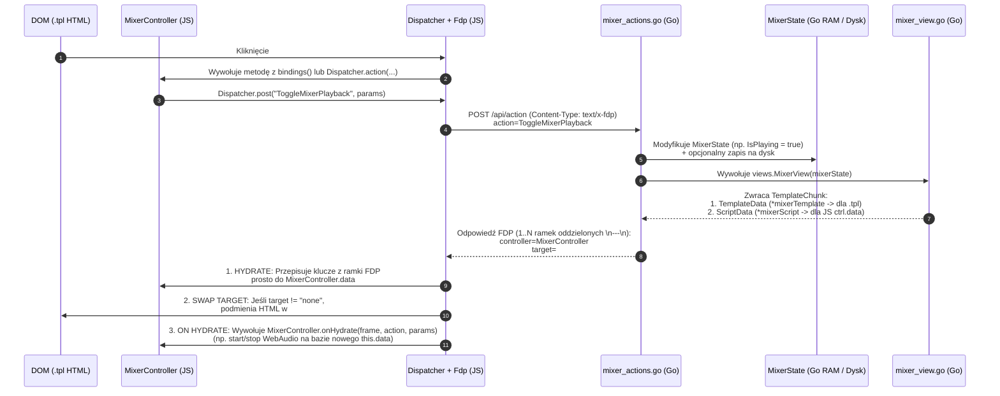

# Jak stworzyć własny moduł (np. `mixer`) i podpiąć go pod App Shell oraz Topbar

W Mojra każdy moduł w `domain/<nazwa>/` to niezależny pakiet z własnym stanem, akcjami, widokiem, szablonem `.tpl`, stylami `.tss` i kontrolerem JS (konwencja **Triady 1:1:1**), a `domain/shell/studio_app` spina je w jedną aplikację.

---

## 0. Jak dane wędrują między Klientem a Serwerem (Graf przepływu FDP)



### Dwa tryby odpowiedzi z Go do JS:
1. **Z podmianą HTML (`Target: commonstate.TargetWorkspace`)**: Go renderuje `mixer_view.tpl` z `mixerTemplate` + wysyła `mixerScript`. `Dispatcher` aktualizuje `MixerController.data`, podmienia `#workspace.innerHTML`, odpala `init` (z `bindings()`), a na koniec `onHydrate`.
2. **Tylko aktualizacja stanu JS bez przeładowania DOM (`Target: commonstate.TargetNone`)**: W `TemplateChunk` ustawiasz `TemplateData: nil`, a wypełniasz samo `ScriptData: &mixerScript{...}`. `Dispatcher` nie dotyka HTML-a (np. nie przerywa odtwarzania audio ani animacji canvasa), tylko aktualizuje `MixerController.data` i wywołuje `MixerController.onHydrate(...)`.

---

## Krok 1. Struktura katalogów nowego modułu (`domain/mixer/`)

Utwórz katalog `domain/mixer/` z dokładnie taką strukturą:

```text
domain/mixer/
├── embed.go
├── state/
│   └── mixer_state.go
├── views/
│   └── mixer_view.go
├── actions/
│   └── mixer_actions.go
├── templates/
│   └── mixer_view.tpl
├── styles/
│   └── mixer.tss
└── controllers/
    └── mixer_controller.js
```

> **Zasada Triady 1:1:1 (`ARCH.md`)**: Nazwa pliku widoku (`mixer_view.go`), szablonu (`mixer_view.tpl`), struktur (`mixerTemplate` / `mixerScript`) i kontrolera (`MixerController` w `mixer_controller.js`) muszą odpowiadać sobie 1:1 — silnik automatycznie mapuje `*mixerTemplate -> mixer_view.tpl` oraz `*mixerScript -> MixerController`.

---

## Krok 2. Zasoby wbudowane (`domain/mixer/embed.go`)

Bundler ładuje szablony, style i skrypty każdego modułu przez `embed.FS`:

```go
package mixer

import "embed"

//go:embed templates/*.tpl styles/*.tss controllers/*.js
var FS embed.FS
```

---

## Krok 3. Stan modułu (`domain/mixer/state/mixer_state.go`)

Stan trzyma wyłącznie dane w pamięci (zero logiki HTTP/HTML) i podpina wspólny `commonstate.UIState`:

```go
package state

import (
	commonstate "mojra/domain/common/state"
)

type MixerState struct {
	*commonstate.UIState
	ActiveTrackID string
	MasterVolume  int
	IsPlaying     bool
}

func (mixer *MixerState) BindUI(ui *commonstate.UIState) {
	mixer.UIState = ui
	if mixer.MasterVolume == 0 {
		mixer.MasterVolume = 80
	}
}
```

---

## Krok 4. Widok Go (`domain/mixer/views/mixer_view.go`)

Widok zamienia `MixerState` na `templates.TemplateChunk`:
- `TemplateData` (`*mixerTemplate`) — dane tylko dla szablonu `.tpl` (`PascalCase`).
- `ScriptData` (`*mixerScript`) — płaskie dane skalarne synchronizowane przez protokół `FDP` prosto do `MixerController.data` w JS (`camelCase`).

```go
package views

import (
	"mojra/domain/mixer/state"
	"mojra/engine/templates"
)

type mixerTemplate struct {
	ActiveTrackID string
	MasterVolume  int
	IsPlaying     bool
}

type mixerScript struct {
	activeTrackId string
	masterVolume  int
	isPlaying     bool
}

func MixerView(mixerState *state.MixerState) templates.TemplateChunk {
	return templates.TemplateChunk{
		TemplateData: &mixerTemplate{
			ActiveTrackID: mixerState.ActiveTrackID,
			MasterVolume:  mixerState.MasterVolume,
			IsPlaying:     mixerState.IsPlaying,
		},
		ScriptData: &mixerScript{
			activeTrackId: mixerState.ActiveTrackID,
			masterVolume:  mixerState.MasterVolume,
			isPlaying:     mixerState.IsPlaying,
		},
	}
}
```

---

## Krok 5. Szablon, Style i Kontroler JS

### 5.1 Szablon (`domain/mixer/templates/mixer_view.tpl`)
Główny kontener widoku musi mieć ID `#mixer-view`. W `.tpl` nie piszemy żadnych handlerów zdarzeń:

```tpl
section.view-panel.mixer-view#mixer-view
    .mixer-toolbar
        span.mixer-title "Audio Mixer"
        button.btn#btn-mixer-toggle .active?: {IsPlaying}
            {if IsPlaying}
                "Stop"
            {else}
                "Play"
    .mixer-stage
        span "Głośność: {MasterVolume}%"
        input#mixer-volume-slider
            type: range
            min: 0
            max: 100
            value: "{MasterVolume}"
        audio#mixer-audio-el
```

### 5.2 Style (`domain/mixer/styles/mixer.tss`)
Składnia `.tss` opiera się na wcięciach (bez `{}` i `;`):

```tss
.mixer-view
    display: flex
    flex-direction: column
    height: 100%
    padding: 24px
    background: --bg-primary
    color: --text-primary
```

### 5.3 Kontroler JS (`domain/mixer/controllers/mixer_controller.js`)
Każdy kontroler ma dokładnie 4 sekcje (`data`, `bindings()`, `settings`, metody) i rejestruje się w `Dispatcher`. Poniżej pełny przykład użycia zarówno `init` (przy montowaniu DOM), jak i `onHydrate` (po każdej odpowiedzi z Go):

```js
"use strict";

const MixerController = {
  // 1. Pola 1:1 zgodne z mixerScript w Go (+ opcjonalne lokalne pola runtime)
  data: {
    activeTrackId: "",
    masterVolume: 80,
    isPlaying: false
  },

  // 2. Deklaratywne bindowanie selektorów CSS do akcji Go lub metod lokalnych
  bindings() {
    return {
      "#mixer-view": {
        init: this.initAudio
      },
      "#btn-mixer-toggle": {
        click: Dispatcher.action("ToggleMixerPlayback")
      },
      "#mixer-volume-slider": {
        change: this.changeVolume
      }
    };
  },

  // 3. Stałe i selektory (zero magic stringów w metodach)
  settings: {
    maxPercent: 100,
    selectors: {
      audioEl: "#mixer-audio-el"
    },
    actions: {
      setVolume: "SetMixerVolume"
    }
  },

  // 4. Metody kontrolera
  // Wywoływane automatycznie przez Dispatcher, gdy #mixer-view pojawia się w DOM
  initAudio() {
    this.syncAudioElement();
  },

  // Wywoływane automatycznie po KAŻDEJ odpowiedzi FDP dla MixerController
  // (gdy this.data ma już świeże wartości z Go mixerScript, nawet przy target=none)
  onHydrate(_frame, _action, _params) {
    this.syncAudioElement();
  },

  // Lokalna metoda odczytująca wartość suwaka i wysyłająca akcję do Go
  changeVolume(_params, sliderEl) {
    Dispatcher.post(this.settings.actions.setVolume, {
      volume: sliderEl.value
    });
  },

  // Synchronizuje element <audio> ze stanem w this.data
  syncAudioElement() {
    const audio = document.querySelector(this.settings.selectors.audioEl);
    if (!audio) return;
    audio.volume = this.data.masterVolume / this.settings.maxPercent;
    if (this.data.isPlaying) {
      audio.play();
    } else {
      audio.pause();
    }
  }
};

Dispatcher.register("MixerController", MixerController);
```

---

## Krok 6. Akcje backendowe (`domain/mixer/actions/mixer_actions.go`)

Akcje odbierają żądania `POST /api/action`, modyfikują stan i zwracają ramki `FDP` (np. pełne odświeżenie `#workspace` przy `ToggleMixerPlayback` albo samą aktualizację `ScriptData` z `TargetNone` przy `SetMixerVolume`):

```go
//go:build !(js && wasm)

package actions

import (
	"strconv"

	commonactions "mojra/domain/common/actions"
	commonstate "mojra/domain/common/state"
	"mojra/domain/mixer/state"
	"mojra/domain/mixer/views"
	"mojra/engine/templates"
	"mojra/engine/transport"
)

const formKeyVolume = "volume"

type ActionHandler func(mixerState *state.MixerState, req *transport.ActionRequest) []transport.ActionFrame

func mixerFromUI(ui *commonstate.UIState) *state.MixerState {
	if ui != nil && ui.Hooks.MixerState != nil {
		if ms, ok := ui.Hooks.MixerState.(*state.MixerState); ok {
			return ms
		}
	}
	return nil
}

func registerActions(actionMap map[string]ActionHandler) bool {
	for actionName, handler := range actionMap {
		boundHandler := handler
		commonactions.RegisterAction(actionName, false, false, func(ui *commonstate.UIState, req *transport.ActionRequest) []transport.ActionFrame {
			ms := mixerFromUI(ui)
			if ms == nil {
				return nil
			}
			return boundHandler(ms, req)
		})
	}
	return true
}

var _ = registerActions(map[string]ActionHandler{
	"ToggleMixerPlayback": toggleMixerPlayback,
	"SetMixerVolume":      setMixerVolume,
})

// Przykład 1: Podmienia HTML w #workspace + aktualizuje MixerController.data
func toggleMixerPlayback(mixerState *state.MixerState, _ *transport.ActionRequest) []transport.ActionFrame {
	mixerState.IsPlaying = !mixerState.IsPlaying
	return []transport.ActionFrame{
		{
			Target: commonstate.TargetWorkspace,
			Chunks: []templates.TemplateChunk{views.MixerView(mixerState)},
		},
	}
}

// Przykład 2: TargetNone — NIE przeładowuje HTML-a (audio gra płynnie dalej),
// tylko wysyła nowe ScriptData do MixerController.data i odpala onHydrate() w JS
func setMixerVolume(mixerState *state.MixerState, req *transport.ActionRequest) []transport.ActionFrame {
	if vol, err := strconv.Atoi(req.FormValue(formKeyVolume)); err == nil && vol >= 0 && vol <= 100 {
		mixerState.MasterVolume = vol
	}
	chunk := views.MixerView(mixerState)
	return []transport.ActionFrame{
		{
			Target: commonstate.TargetNone,
			Chunks: []templates.TemplateChunk{{ScriptData: chunk.ScriptData}},
		},
	}
}
```

---

## Krok 7. Podpięcie modułu pod App Shell (`studio_app`) i `#topbar`

Teraz wpinamy `mixer` jako 4. równorzędny widok obok `library`, `player` i `editor`:

### 1. Dodaj stałą widoku i hook w `domain/common/state/ui_state.go`
- W `const` obok `ViewEditor` dodaj:
  ```go
  ViewMixer ViewMode = "mixer"
  ```
- W `struct ShellHooks` dodaj pole:
  ```go
  MixerState any
  ```

### 2. Zarejestruj moduł w `domain/shell/studio_app/modules.cfg`
Dopisz `mixer` na końcu pliku, żeby bundler kompilował jego `.tpl`, `.tss` i `.js`:
```cfg
common
player
library
studio
mixer
```

### 3. Dodaj stan modułu do `domain/shell/studio_app/state/shell_state.go`
- W `const` wyeksportuj `ViewMixer = commonstate.ViewMixer`.
- W `ParseWorkspaceView(raw string)` dodaj obsługę `case string(ViewMixer): return ViewMixer`.
- W `struct AppState` dodaj pole `Mixer mixerstate.MixerState`.
- W `BindSubstates()` dodaj:
  ```go
  s.Mixer.BindUI(s.UIState)
  s.Hooks.MixerState = &s.Mixer
  ```
- W `ActiveWorkspaceView(s *AppState)` dodaj `case ViewMixer: return ViewMixer`.

### 4. Wskaż widok w `domain/shell/studio_app/views/shell_view.go`
W funkcji `ActiveWorkspaceView(s *state.AppState)` dopisz case zwracający Twój widok do `#workspace`:
```go
case state.ViewMixer:
    return mixerviews.MixerView(&s.Mixer)
```

### 5. Podłącz FS i przełączanie widoku w `domain/shell/studio_app/actions/shell_actions.go`
- Zaimportuj `"mojra/domain/mixer"` oraz `_ "mojra/domain/mixer/actions"` (żeby wykonał się `registerActions`).
- W `StudioAppModules()` dodaj `"mixer": mixer.FS` do mapy `registry`.
- W `switchView(...)` dodaj `view == string(state.ViewMixer)` do warunku dozwolonych widoków, aby akcja `SwitchView` zapisywała `s.Settings.ActiveView = view`, zamykała modale (`s.CloseAllModals()`) i zwracała `s.Hooks.RenderAppFrames()`.

### 6. Dodaj przycisk przełącznika w Topbarze
1. **`domain/shell/studio_app/views/topbar_view.go`**:
   Dodaj `IsViewMixer bool` do `topbarTemplate` i ustaw `IsViewMixer: activeView == state.ViewMixer`.
2. **`domain/shell/studio_app/templates/topbar_view.tpl`**:
   W `.topbar-actions-menu` (lub `.topbar-left`) dodaj przycisk:
   ```tpl
   button.top-action-btn.icon-toggle-btn#tab-mixer .active?: {IsViewMixer}
       data-hint: "Audio Mixer"
       svg.action-icon src: /icons/mic.svg
   ```
3. **`domain/shell/studio_app/controllers/topbar_controller.js`**:
   Podłącz kliknięcie pod akcję `SwitchView`:
   ```js
   // w bindings():
   "#tab-mixer": {
     click: this.switchToMixer
   },
   // w settings.vals:
   mixerView: "mixer",
   // w metodach:
   switchToMixer() {
     Dispatcher.post(this.settings.actions.switchView, {
       view: this.settings.vals.mixerView
     });
   }
   ```

---

## Krok 8. Sprawdzenie i budowanie

Uruchom testy kontraktów oraz bundlera i zbuduj aplikację:

```bash
go test ./...
./build.sh --macos
```

---

## Krok 9. FAQ: Jak pod spodem działają `onHydrate`, `commonstate` i zapis na dysk?

### 1. Co to jest `onHydrate(frame, action, params)` w kontrolerze JS?
Gdy Go zwraca odpowiedź `FDP` po `POST /api/action`, `Dispatcher` w przeglądarce wykonuje po kolei 3 rzeczy:
1. **Hydracja danych (`ScriptData -> ctrl.data`)**: Przepisuje wszystkie pola z Go `mixerScript` (np. `isPlaying=true`, `masterVolume=80`) prosto do obiektu `MixerController.data` w JS (automatycznie rzutując `"true"` na `bool`, a liczby na `Number`).
2. **Podmiana HTML (`target`)**: Jeśli ramka ma np. `target=#workspace`, podmienia DOM i odpala `init` z `bindings()`.
3. **Callback `onHydrate(frame, action, params)`**: Wywołuje `MixerController.onHydrate(...)` **po** zaktualizowaniu `this.data` i DOM-u.
   - Używasz go wtedy, gdy po odpowiedzi z serwera musisz wykonać efekt uboczny w przeglądarce (np. odpalić WebAudio API, przerysować WebGL/Canvas albo ustawić pozycję suwaka, gdy wysłałeś ramkę z `target=none` bez przeładowania HTML-a).
   - Jeśli Twój widok tylko podmienia HTML przez `.tpl`, `onHydrate` nie jest potrzebny.

### 2. Po co w stanie modułu podpina się `*commonstate.UIState` (`BindUI`)?
`commonstate.UIState` to wspólny „kręgosłup” dzielony przez wszystkie moduły bez tworzenia cyklicznych importów w Go:
- **`s.Mu` (`sync.Mutex`)**: Jeden wspólny mutex chroniący stan aplikacji podczas requestów.
- **`s.Config`**: Ścieżki uruchomieniowe (`BooksDir`, `SavesDir`, `RootDir`, `DevMode`).
- **`s.Settings`**: Globalne ustawienia z `saves/settings.ini` (motyw, skala UI, aktywna książka) + metoda `s.SaveSettings()`.
- **`s.Overlays.Toast`**: Wyświetlanie dymków powiadomień (ustawiasz `mixerState.Overlays.Toast = "Zapisano ścieżkę"` i UI samo pokaże toast po akcji).
- **`s.Confirm`**: Otwieranie globalnego modala potwierdzenia (`#modal-confirm`).
- **`s.Hooks`**: Callbacki między modułami (np. `s.Hooks.ActiveContextBook()` daje aktualnie otwartą książkę z Playera lub Studio, a `s.Hooks.OnBookMutated(b)` powiadamia resztę aplikacji, że zmieniłeś książkę).

### 3. Gdzie i jak zapisać stan na dysku? (Zero JSON / Zero SQL)
W zależności od tego, **co** zapisujesz, w Mojra są 3 miejsca zapisu na dysku:

1. **W plikach książki (`books/<id>/...`) — gdy edytujesz zawartość projektu**:
   - **Metadane książki (`book.playtxt`)**: Dodajesz pole do `model.Book` (`domain/book/model/book_model.go`), dopisujesz obsługę klucza `key: value` w parserze (`domain/book/actions/parser.go`) i serializerze (`SerializeDataFile` w `domain/book/actions/serializer.go`), a zapisujesz wywołując `book.SaveBookMetadataToDisk(activeBook)`.
   - **Sceny i rozdziały (`story.playtxt` / `<chapter>.playtxt`)**: Dodajesz pole do `model.Scene`, obsługujesz nagłówek w `parser.go` i `serializer.go`, a zapisujesz przez `book.SaveBookScenesToDisk(activeBook)` (oraz `s.Hooks.OnBookMutated(activeBook)`).
   - **Układ / stan edytora per książka (`books/<id>/.editor.cfg`)**: Prosty plik tekstowy `klucz: wartość` ładowany i zapisywany przez `book.SaveEditorLayout(activeBook)` w `domain/book/actions/layout.go`.

2. **Globalne ustawienia aplikacji (`saves/settings.ini` w OS AppData)**:
   - Dodajesz pole do `model.AppSettings`, dopisujesz sekcję/klucz INI w `LoadAppSettings` / `SaveAppSettings`, a w akcji swojego modułu wywołujesz po prostu `mixerState.SaveSettings()`.

3. **Postęp gracza (`saves/<book-id>.sav` w OS AppData)**:
   - Binarny format Little-Endian (`STSV\x01`) w `domain/book/actions/save_codec.go`, zapisywany przez `book.SaveSaveState(savesDir, save)`.

