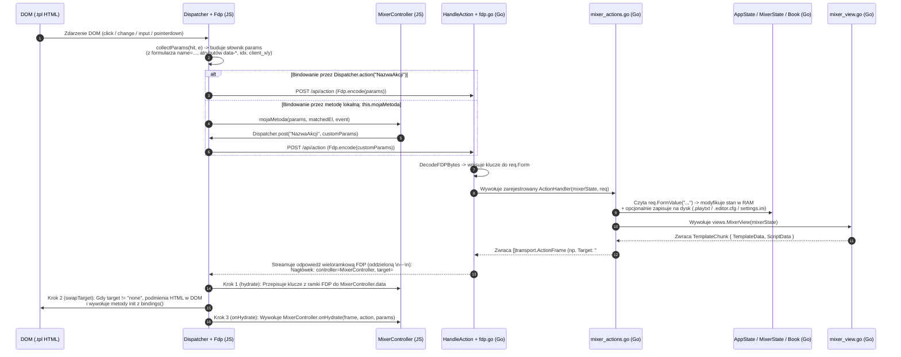
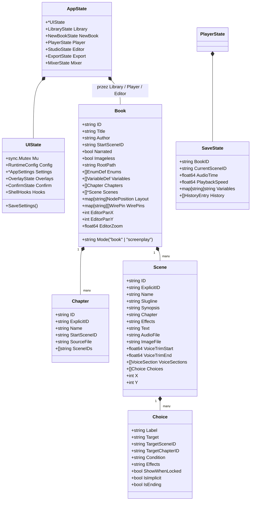
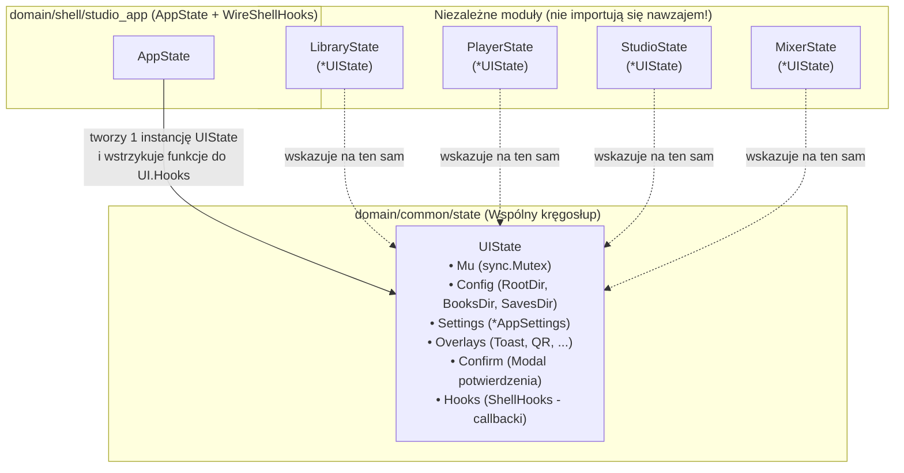
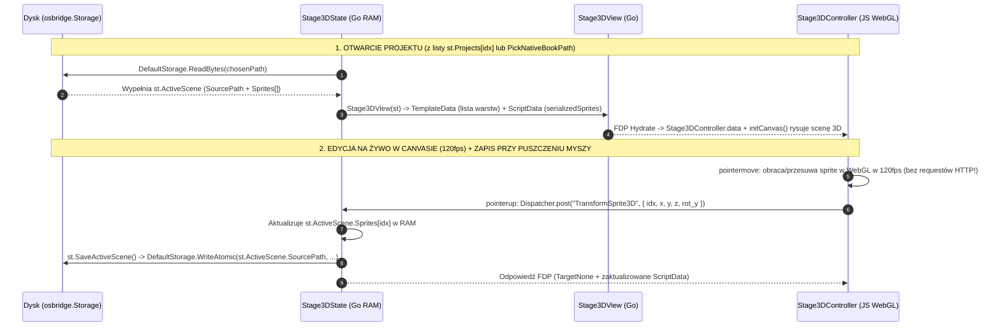
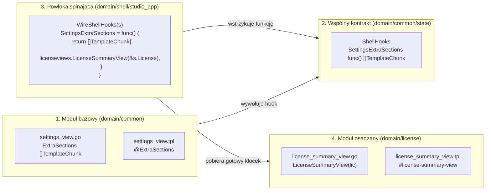

# Przewodnik Architektury Mojra: Model Danych, Protokół FDP i Tworzenie Własnego Modułu

Kompletny przewodnik dla programisty pokazujący:
1. Jak dane płyną między przeglądarką a serwerem Go (`FlatDataProtocol` / `FDP`).
2. Jak wygląda pełny **Model Danych** w pamięci i na dysku.
3. Jak działa `Dispatcher` w JS (skąd biorą się `params`, `matchedEl`, `init` i `onHydrate`).
4. Jak od zera napisać własny moduł (np. `mixer` — edytor ścieżek dźwiękowych) i podpiąć go pod App Shell (`studio_app`) oraz pasek górny (`#topbar`).

---

## 1. Jak dane wędrują między Klientem a Serwerem (Protokół `FDP`)

W Mojra **nie ma JSON-a, REST-owych osobnych endpointów ani ręcznego sklejania HTML-a w JS**. Cała komunikacja idzie przez jeden endpoint `POST /api/action` (lub mostek WASM) w formacie tekstowym **`FDP` (`FlatDataProtocol`, `Content-Type: text/x-fdp;charset=UTF-8`)**.



---

### 1.1 Jak wygląda Surowy Pakiet `FDP` na kablu?

#### Żądanie (Request: Przeglądarka -> Go)
Gdy użytkownik kliknie przycisk lub przesunie suwak, `Fdp.encode(params)` wysyła w ciele `POST /api/action` płaskie linie `klucz=wartość` (plus opcjonalne pole wieloliniowe po `\n\n`, jeśli ustawiono `_body`):

```text
action=SaveTrackSettings
idx=1
track_id=trk_ambient_02
track_name=Ambient Las
volume=80
pan=-20
loop_mode=infinite
```

Jeżeli przesyłasz duży, wieloliniowy tekst (np. treść sceny w kluczu `text`), `Fdp.encode` automatycznie przenosi go na koniec po pustej linii `\n\n`, wskazując jego nazwę w `_body`:

```text
action=SaveSceneText
scene=las_noc
_body=text

Wnętrze starego młyna.
Słychać skrzypienie koła wodnego.
```

Po stronie Go funkcja `transport.ParseActionRequest(request)` dekoduje ten payload przez `DecodeFDPBytes` i wrzuca wszystkie klucze (łącznie z tym z `_body`) do standardowego `request.Form` (`url.Values`). Dzięki temu w Go czytasz wszystko jednolicie przez:

```go
trackID   := req.FormValue("track_id")   // "trk_ambient_02"
trackName := req.FormValue("track_name") // "Ambient Las"
volume    := req.FormValue("volume")     // "80"
```

---

#### Odpowiedź (Response: Go -> Przeglądarka)
Serwer Go odpowiada jedną lub wieloma ramkami `FDP` oddzielonymi separatorem `\n---\n`. **Jedna ramka = jeden kontroler JS**:

```text
controller=MixerController
target=#workspace
activeTrackId=trk_ambient_02
masterVolume=80
isPlaying=true
_body=html

<section class="view-panel mixer-view" id="mixer-view">
  ...wyrenderowany HTML z mixer_view.tpl...
</section>
---
controller=UIController
target=none
theme=dark
toast=Zapisano ustawienia ścieżki
```

Zwróć uwagę na dwie rzeczy:
1. Pierwsza ramka ma `target=#workspace` oraz `_body=html` — `Dispatcher` zaktualizuje `MixerController.data`, podmieni HTML wewnątrz `<main id="workspace">`, odpali `init`, a potem `MixerController.onHydrate(...)`.
2. Druga ramka ma `target=none` (brak HTML-a) — `Dispatcher` tylko przepisze `toast="Zapisano ustawienia ścieżki"` do `UIController.data.toast` i wywoła `UIController.onHydrate(...)`, który wyświetli dymek z komunikatem bez ruszania DOM-u reszty aplikacji.

---

## 2. Pełny Model Danych Mojra (Go Structs & Relacje)

Architektura dzieli dane na **3 warstwy**:
1. **Model Domenowy (`domain/book/model/`)** — czyste struktury danych książki, scen, zmiennych, zapisu gry i ustawień (zero zależności od HTTP czy szablonów).
2. **Stan Aplikacji w RAM (`domain/*/state/`)** — trzyma aktualnie otwarte obiekty w pamięci podczas działania programu.
3. **Kontrakt Widoku (`domain/*/views/` + `engine/templates`)** — `TemplateChunk` (`*<name>Template` dla `.tpl` + `*<name>Script` dla JS `ctrl.data`).



---

### 2.1 Kluczowe struktury w `domain/book/model/`

#### `model.Book` (`domain/book/model/book.go`) — Projekt książki / scenariusza
Reprezentuje wczytaną książkę z katalogu `books/<id>/` lub archiwum `.playbook`:
```go
type Book struct {
	ID              string                   // Slug katalogu, np. "metro_2033"
	Title           string                   // Tytuł z book.playtxt (title:)
	Author          string                   // Autor z book.playtxt (author:)
	License         string                   // Licencja (license:)
	Description     string                   // Opis (description:)
	Mode            string                   // "book" lub "screenplay"
	ScriptStandard  string                   // "pl", "eu" lub "us" (dla scenariusza)
	StartSceneID    string                   // ID sceny początkowej (start:)
	Narrated        bool                     // Czy książka ma lektora/audio (narrated: true|false)
	Imageless       bool                     // Tryb bez ilustracji (imageless: true|false)
	CoverFile       string                   // Ścieżka względna okładki (cover:)
	RootPath        string                   // Pełna ścieżka na dysku do folderu książki
	IsPacked        bool                     // true jeśli to archiwum .playbook (tylko do odczytu!)
	AudioFiles      []string                 // Lista plików w folderze voice/ (.ogg, .flac, .mp3)
	ImageFiles      []string                 // Lista plików w folderze img/ (.png, .jpg, .webp)
	Enums           []EnumDef                // Definicje typów wyliczeniowych (enum:)
	Variables       []VariableDef            // Definicje zmiennych fabularnych (var:)
	Chapters        []Chapter                // Rozdziały / Akty uporządkowane grafowo (BFS)
	Scenes          []*Scene                 // Wszystkie sceny w książce
	Layout          map[string]NodePosition  // Pozycje węzłów (X, Y) z pliku .editor.cfg
	WirePins        map[string][]WirePin     // Punkty załamania kabli na siatce z .editor.cfg
	EditorPanX      int                      // Przesunięcie kamery X w Node Studio
	EditorPanY      int                      // Przesunięcie kamery Y w Node Studio
	EditorZoom      float64                  // Zoom kamery w Node Studio
}
```
Najważniejsze metody pomocnicze na `*model.Book`:
- `b.FindScene(sceneID string) *Scene` — znajduje scenę po `ID`, `ExplicitID` lub nazwie.
- `b.FindChapter(nameOrID string) *Chapter` — znajduje rozdział/akt.
- `b.FindVariable(varName string) *VariableDef` — znajduje zmienną fabularną.
- `b.CurrentScene(save *SaveState) *Scene` — zwraca aktualną scenę gracza na podstawie zapisu.

#### `model.Scene` (`domain/book/model/book.go`) — Pojedyncza scena
```go
type Scene struct {
	ID             string                      // Wewnętrzny lub jawny identyfikator (np. "s1" lub "las_noc")
	ExplicitID     string                      // Jawne id: wpisane przez autora w .playtxt
	Name           string                      // Tytuł sceny (scene:)
	Slugline       string                      // Nagłówek scenariusza (np. "WN. MŁYN - NOC")
	Synopsis       string                      // Krótki opis sceny (synopsis:)
	Effects        string                      // Modyfikacje zmiennych przy wejściu (np. "zloto += 10; klucz = true")
	Chapter        string                      // Nazwa rozdziału / aktu (chapter:)
	SourceFile     string                      // Nazwa pliku .playtxt, w którym leży scena
	Text           string                      // Surowa treść prozy / dialogów
	AudioFile      string                      // Ścieżka względna do pliku audio (np. "voice/s1.ogg")
	ImageFile      string                      // Ścieżka względna do obrazu (np. "img/las.webp")
	AudioURL       string                      // Gotowy URL HTTP: "/api/books/<bookID>/media/voice/s1.ogg"
	ImageURL       string                      // Gotowy URL HTTP: "/api/books/<bookID>/media/img/las.webp"
	VoiceTrimStart float64                     // Początek przycięcia audio [0.0 .. 1.0]
	VoiceTrimEnd   float64                     // Koniec przycięcia audio [0.0 .. 1.0]
	SectionVoices  map[string]VoiceSectionMeta // Audio dla warunkowych sekcji tekstu
	VoiceSections  []VoiceSection              // Wyliczone sekcje głosowe sceny
	Choices        []Choice                    // Wyjścia ze sceny (wybory gracza lub przejście "Dalej")
	X, Y           int                         // Pozycja karty na płótnie w Studio (wielokrotność 24px)
}
```

#### `model.Choice` (`domain/book/model/book.go`) — Przejście / Wybór
```go
type Choice struct {
	Label           string // Tekst na przycisku wyboru (np. "Otwórz drzwi")
	TargetSceneID   string // Docelowe ID sceny (np. "korytarz")
	TargetChapterID string // Docelowy rozdział, jeśli przejście prowadzi do innego rozdziału
	Condition       string // Warunek widoczności/odblokowania, np. "klucz == true && zloto >= 5"
	Effects         string // Efekty wykonania wyboru, np. "zloto -= 5"
	ShowWhenLocked  bool   // Czy pokazać wyszarzony wybór, gdy warunek nie jest spełniony
	IsImplicit      bool   // true gdy to pojedyncze przejście "Dalej" (next:)
	IsEnding        bool   // true gdy prowadzi do końca historii (-> END)
}
```

#### `model.SaveState` i `model.AppSettings` (`domain/book/model/save.go`)
- **`SaveState`**: Zapis postępu czytelnika w konkretnej książce (`saves/<book-id>.sav`) — trzyma `CurrentSceneID`, `AudioTime`, `Variables map[string]string` (aktualne wartości zmiennych gracza) oraz `History []HistoryEntry` (odwiedzone sceny).
- **`AppSettings`**: Globalne ustawienia programu (`saves/settings.ini`) — trzyma `Theme` (`"dark"`/`"light"`), `UIScale`, `ActiveView` (`"library"`, `"player"`, `"editor"`, ...), `ActiveBookID`, `EditorBookID` oraz `ExternalBooks`.

---

### 2.2 Struktury Transportu i Widoku (`engine/templates` i `engine/transport`)

Kiedy akcja w Go kończy pracę, zwraca `[]transport.ActionFrame`:

```go
// Pojedyncza paczka widoku: dane dla szablonu HTML + dane dla kontrolera JS
type TemplateChunk struct {
	TemplateData any // wskaźnik na *<name>Template -> renderowany przez <name>_view.tpl
	ScriptData   any // wskaźnik na *<name>Script   -> wysyłany jako key=val do <Name>Controller.data
}

// Ramka odpowiedzi FDP wskazująca, który kontener DOM podmienić
type ActionFrame struct {
	Target     string                    // "#app", "#workspace", "#modals-root", "#editor-context-view" lub "none"
	Chunks     []templates.TemplateChunk // Chunki do wyrenderowania
	KeepScroll bool                      // Jeśli true, nie odpala ponownie init po podmianie DOM
}
```

---

## 3. Jak `Dispatcher` w JS zbiera `params` i wywołuje metody kontrolera?

Wielu programistów pyta: *„Skąd metoda w kontrolerze JS wie, jakie ma argumenty i co siedzi w `params`?”*

Całą czarną robotę robi `engine/scripts/dispatcher.js`. Każda metoda podpięta w `bindings()` jest wywoływana z **dokładnie trzema argumentami**:

```js
mojaMetoda(params, matchedEl, event)
```

| Argument | Typ | Co dokładnie zawiera? |
| :--- | :--- | :--- |
| **`params`** | `Object` (słownik `klucz: wartość`) | Automatycznie zebrane dane z klikniętego/zmienionego elementu oraz jego formularza (szczegóły niżej). |
| **`matchedEl`** | `HTMLElement` | Konkretny element DOM, który dopasował się do selektora z `bindings()` (np. kliknięty `<button>` albo zmieniony `<input>`). |
| **`event`** | `Event` | Natywne zdarzenie przeglądarki (`MouseEvent`, `KeyboardEvent`, `InputEvent`). |

> **Konwencja `_params`**: W JS znak podkreślenia na początku nazwy parametru (np. `_params`) nic nie zmienia w działaniu języka — to tylko sygnał dla czytelnika i lintera: *„w tej funkcji nie korzystam z pierwszego argumentu, bo potrzebuję drugiego (`sliderEl`)”*.

### Skąd `Dispatcher.collectParams` bierze klucze w `params`? (I dlaczego NIE przemycamy stanu z backendu w `data-*`!)

> **Ważna zasada architektury (`ARCH.md` 4.3 — Zero State-Shuttling `data-*`)**:
> Nigdy nie doklejamy danych domenowych z backendu do HTML-a przez atrybuty `data-scene-id="{SceneID}"` czy `data-track-id="..."` tylko po to, żeby JS odesłał je z powrotem do Go!
> - Stan widoku z Go do JS zawsze podróżuje przez **`ScriptData` (`FDP`) -> `Controller.data`**.
> - Kliknięty element na liście (np. która ścieżka lub który wybór został kliknięty) identyfikujemy automatycznie przez **`params.idx` (`0, 1, 2...`)**, a w Go sięgamy po `activeBook.Scenes[idx]`.

Gdy klikniesz element lub zmienisz pole formularza, `Dispatcher` buduje słownik `params` w następujących krokach:
1. **`params.idx` (Indeks elementu na liście w $O(1)$)**: Przy każdym montowaniu DOM (`Dispatcher.mountAll`) każdy element pasujący do selektora z `bindings()` dostaje swój indeks `_idx` (`0, 1, 2...`). Gdy klikniesz np. 3. wiersz `.mixer-select-track`, `Dispatcher` automatycznie wstawia `params.idx = 2` — bez żadnych atrybutów `data-*` w `.tpl`!
2. **Wszystkie pola `<form>` (`name: ...`)**: Jeśli element leży wewnątrz `<form>`, wszystkie `<input name="...">`, `<textarea name="...">` z tego formularza trafiają do `params[name] = value`.
3. **Sam element (`el.name`)**: Jeśli sam zmieniany `<input>` ma atrybut `name: volume` (nawet bez `<form>`), do `params` trafia `params.volume = el.value`.
4. **Statyczne przełączniki UI (`data-*`)**: Używane wyłącznie dla stałych przełączników widoku/trybu zadeklarowanych w szablonie (np. `data-mode: portrait` na pasku podglądu urządzeń lub `data-view: studio` w Topbarze), nigdy do przemycania dynamicznych encji z backendu.
5. **Współrzędne myszy**: Przy kliknięciach i ruchach kursora dodawane są `params.client_x` oraz `params.client_y`.

#### Przykład: Wiele parametrów z formularza + automatyczny `idx` (Zero `data-*`, zero własnego kodu JS!)
Jeśli w szablonie `.tpl` masz listę kart formularzy:
```tpl
{for track in Tracks}
    form.track-card
        input name: track_name value: "{track.SceneName}"
        input name: volume value: "{track.Volume}"
        input name: pan value: "{track.Pan}"
        button.btn-save-track "Zapisz ścieżkę"
```
A w `bindings()` kontrolera podepniesz ten przycisk bezpośrednio pod akcję Go:
```js
".btn-save-track": {
  click: Dispatcher.action("SaveTrack")
}
```
To po kliknięciu 3. karty na liście (`idx = 2`) `Dispatcher` sam zbierze obiekt `params`:
```js
{
  idx: 2,                  // automatyczny indeks klikniętego .btn-save-track (0, 1, 2...)
  track_name: "Deszcz w lesie",
  volume: "75",
  pan: "-15",
  client_x: 540,
  client_y: 310
}
```
Następnie zakoduje go przez `Fdp.encode` i wyśle do Go, gdzie odczytasz indeks oraz pola formularza:
```go
idx, _    := strconv.Atoi(req.FormValue("idx")) // 2 -> activeBook.Scenes[2]
trackName := req.FormValue("track_name")        // "Deszcz w lesie"
volume    := req.FormValue("volume")            // "75"
pan       := req.FormValue("pan")               // "-15"
```

---

### 3.1 Minimalny przykład: 1 przycisk i odpowiedź renderująca TYLKO szablon (bez `ScriptData` i bez logiki w JS)

Nie każdy widok potrzebuje `ScriptData`, `this.data` czy `onHydrate`. Jeśli chcesz tylko kliknąć przycisk, zmienić coś w Go i przeładować HTML szablonu `.tpl`:

#### 1. Widok Go (`stats_view.go`) — samo `TemplateData`, zero `ScriptData`
Nie definiujesz w ogóle struktury `*Script` i nie ustawiasz `ScriptData`:
```go
package views

import (
	"mojra/domain/mixer/state"
	"mojra/engine/templates"
)

type statsTemplate struct {
	ClicksCount int
}

func StatsView(s *state.MixerState) templates.TemplateChunk {
	return templates.TemplateChunk{
		TemplateData: &statsTemplate{
			ClicksCount: s.MasterVolume,
		},
		// ScriptData pomijamy (jest nil)
	}
}
```

#### 2. Szablon (`stats_view.tpl`) — 1 czysty przycisk i tekst (zero `data-*`)
```tpl
section.view-panel#stats-view
    p "Liczba kliknięć: {ClicksCount}"
    button.btn#btn-add-click "Dodaj +1"
```

#### 3. Akcja Go (`mixer_actions.go`) — odbiera kliknięcie i zwraca odświeżony szablon
```go
var _ = registerActions(map[string]ActionHandler{
	"AddClick": addClick,
})

func addClick(s *state.MixerState, _ *transport.ActionRequest) []transport.ActionFrame {
	s.MasterVolume++

	return []transport.ActionFrame{
		{
			Target: commonstate.TargetWorkspace,
			Chunks: []templates.TemplateChunk{views.StatsView(s)},
		},
	}
}
```

#### 4. Co idzie po kablu `FDP`?
- **Request z przeglądarki (`POST /api/action`)**:
  ```text
  action=AddClick
  idx=0
  ```
- **Response z serwera Go**:
  ```text
  controller=StatsController
  target=#workspace
  _body=html

  <section class="view-panel" id="stats-view"><p>Liczba kliknięć: 81</p><button type="button" class="btn" id="btn-add-click">Dodaj +1</button></section>
  ```
  *(Brak jakichkolwiek pól `ScriptData` w nagłówku — jest tylko `target=#workspace` i czysty HTML).*

#### 5. A co z plikiem JS?
- **Gdy widok nie ma w środku żadnych własnych przycisków** (jest np. czysto informacyjnym podglądem otwieranym z Topbara): **nie tworzysz pliku `stats_controller.js` wcale**. `Dispatcher` widząc `target=#workspace` podmieni HTML i zignoruje brak kontrolera.
- **Gdy w widoku jest przycisk `#btn-add-click`**: ponieważ w `.tpl` zakazane jest pisanie inline `onclick="..."`, dodajesz jedynie 5-linijkową deklarację `bindings()` (bez żadnych pól w `data`, bez `settings` i bez żadnych metod):
  ```js
  "use strict";

  const StatsController = {
    data: {},
    bindings() {
      return {
        "#btn-add-click": {
          click: Dispatcher.action("AddClick")
        }
      };
    },
    settings: {}
  };

  Dispatcher.register("StatsController", StatsController);
  ```

---

## 4. Tutorial Krok po Kroku: Tworzymy własny moduł `domain/mixer/`

Załóżmy, że budujemy nowy moduł **`mixer`** (edytor ścieżek dźwiękowych dla aktywnej książki) i chcemy mieć do niego przełącznik w `#topbar` równolegle do `Biblioteka`, `Player` i `Playbook Studio`.

### Krok 1. Struktura katalogów (`domain/mixer/`)

```text
domain/mixer/
├── embed.go
├── state/
│   └── mixer_state.go
├── views/
│   └── mixer_view.go
├── actions/
│   └── mixer_actions.go
├── templates/
│   └── mixer_view.tpl
├── styles/
│   └── mixer.tss
└── controllers/
    └── mixer_controller.js
```

> **Zasada Triady 1:1:1 (`ARCH.md`)**: Nazwy muszą pasować do siebie 1:1:
> - plik widoku: `mixer_view.go` -> konstruktor `MixerView` -> struktury `mixerTemplate` i `mixerScript`
> - plik szablonu: `mixer_view.tpl` -> główny element `#mixer-view`
> - plik kontrolera: `mixer_controller.js` -> obiekt `MixerController`
> Silnik Go używa refleksji na nazwach typów `*mixerTemplate` i `*mixerScript`, żeby automatycznie powiązać je z `mixer_view.tpl` i `MixerController` (zero ręcznych map!).

---

### Krok 2. Zasoby wbudowane (`domain/mixer/embed.go`)

```go
package mixer

import "embed"

//go:embed templates/*.tpl styles/*.tss controllers/*.js
var FS embed.FS
```

---

### Krok 3. Stan modułu (`domain/mixer/state/mixer_state.go`) oraz rola `commonstate.UIState` i `Hooks`

Stan przechowuje bieżące dane modułu w pamięci RAM i osadza (embeduje) wspólny wskaźnik `*commonstate.UIState`:

```go
package state

import (
	commonstate "mojra/domain/common/state"
)

type MixerState struct {
	*commonstate.UIState
	SelectedSceneID string
	MasterVolume    int
	IsPlaying       bool
}

func (mixer *MixerState) BindUI(ui *commonstate.UIState) {
	mixer.UIState = ui
	if mixer.MasterVolume == 0 {
		mixer.MasterVolume = 80
	}
}
```

#### Po co w `MixerState` jest `*commonstate.UIState` i co z nim robimy dalej?

W Go obowiązuje twardy zakaz cyklicznych importów (`import cycle not allowed`). Ponieważ główna powłoka `domain/shell/studio_app` importuje wszystkie moduły (`library`, `player`, `studio`, `mixer`), **moduł `mixer` nie może zaimportować `studio_app`, `player` ani `studio`**.

Żeby mimo to `mixer` miał dostęp do aktualnie otwartej książki, ustawień, powiadomień (toastów) i mógł komunikować się z innymi modułami, wszystkie moduły dzielą jeden wspólny wskaźnik `*commonstate.UIState`:



Dzięki temu, że `*commonstate.UIState` jest wbudowany w `MixerState`, w każdej funkcji przyjmującej `mixerState *state.MixerState` możesz pisać bezpośrednio:

1. **Dostęp do ustawień i ścieżek dyskowych**:
   ```go
   booksDir := mixerState.Config.BooksDir
   savesDir := mixerState.Config.SavesDir
   isDark   := mixerState.Settings.Theme == "dark"
   mixerState.SaveSettings() // atomowy zapis do saves/settings.ini
   ```
2. **Wyświetlanie powiadomień (Toastów) na ekranie**:
   ```go
   mixerState.Overlays.Toast = "Zapisano ścieżkę audio!"
   // Po zakończeniu akcji serwer automatycznie dośle ramkę FDP do UIController i wyświetli toast.
   ```
3. **Otwieranie globalnego okna potwierdzenia (`#modal-confirm`)**:
   ```go
   mixerState.Confirm.Prompt(
       "Usuń nagranie",
       "Czy na pewno chcesz usunąć plik audio tej sceny?",
       "Usuń",
       "DeleteMixerTrack",
       sceneID,
   )
   return []transport.ActionFrame{mixerState.Hooks.RenderModalsFrame()}
   ```
4. **Odbieranie akcji z globalnego routera HTTP (`commonactions.Handlers`)**:
   Globalny serwer przy każdym `POST /api/action` przekazuje do handlera `*commonstate.UIState`. W `BindSubstates()` zapisaliśmy `s.Hooks.MixerState = &s.Mixer`, więc funkcja `mixerFromUI(ui)` w `mixer_actions.go` wyciąga z `ui.Hooks.MixerState` Twój `*state.MixerState`.

---

#### Jak dokładnie działają `Hooks` (`mixerState.Hooks.*`)?

`ShellHooks` (w `domain/common/state/ui_state.go`) to zestaw pól funkcyjnych (callbacków). Sam pakiet `common` tylko deklaruje ich sygnatury, natomiast **wypełnia je `WireShellHooks(appState)` w `domain/shell/studio_app/actions/shell_actions.go`**, bo `studio_app` widzi jednocześnie `Library`, `Player`, `Editor` i `Mixer`.

Oto jak to działa krok po kroku na przykładzie pobrania i modyfikacji książki w `mixer`:

1. **W `domain/common/state/ui_state.go` (deklaracja pola funkcyjnego)**:
   ```go
   type ShellHooks struct {
       ActiveContextBook func() *model.Book
       OnBookMutated     func(mutatedBook *model.Book)
       RenderAppFrames   func() []transport.ActionFrame
       // ...
   }
   ```
2. **W `domain/shell/studio_app/actions/shell_actions.go` (podpięcie implementacji przy starcie aplikacji)**:
   ```go
   // studio_app ma dostęp do s.Editor, s.Player i s.Library:
   s.Hooks.ActiveContextBook = func() *book.Book {
       return ContextBook(s) // zwraca książkę ze Studio lub Playera
   }
   s.Hooks.OnBookMutated = func(mutated *book.Book) {
       s.Library.Put(mutated)       // aktualizuje książkę w Bibliotece
       s.Player.Book = mutated      // aktualizuje książkę w Playerze
   }
   ```
3. **W Twoim module `domain/mixer/actions/mixer_actions.go` (użycie bez znajomości `Player` czy `Library`)**:
   ```go
   func normalizeTrackAudio(mixerState *state.MixerState, req *transport.ActionRequest) []transport.ActionFrame {
       // 1. Pobierasz aktualnie otwartą książkę przez Hook:
       activeBook := mixerState.Hooks.ActiveContextBook()
       if activeBook == nil || activeBook.IsPacked {
           mixerState.Overlays.Toast = "Brak edytowalnej książki"
           return nil
       }

       // 2. Modyfikujesz scenę i zapisujesz na dysk:
       if scene := activeBook.FindScene(mixerState.SelectedSceneID); scene != nil {
           scene.VoiceTrimStart = 0.05
           scene.VoiceTrimEnd = 0.95
           _ = book.SaveBookScenesToDisk(activeBook)
       }

       // 3. Powiadamiasz resztę aplikacji (Bibliotekę i Player) przez Hook:
       mixerState.Hooks.OnBookMutated(activeBook)

       // 4. Ustawiasz Toast w UIState i odświeżasz widok:
       mixerState.Overlays.Toast = "Znormalizowano ścieżkę"
       return []transport.ActionFrame{
           {
               Target: commonstate.TargetWorkspace,
               Chunks: []templates.TemplateChunk{views.MixerView(mixerState)},
           },
       }
   }
   ```

| Najważniejsze Hooki w `mixerState.Hooks` | Co robią po wywołaniu? |
| :--- | :--- |
| `ActiveContextBook() *model.Book` | Zwraca aktualnie otwartą książkę (ze Studio lub z Playera). |
| `ListAllBooks() []*model.Book` | Zwraca listę wszystkich książek wczytanych w Bibliotece. |
| `OnBookMutated(b *model.Book)` | Aktualizuje zmodyfikowaną książkę we wszystkich pozostałych modułach (`Library`, `Player`). |
| `OpenBookInView(bookID, view)` | Otwiera wskazaną książkę i przełącza aplikację na dany widok (np. `commonstate.ViewEditor`). |
| `RenderAppFrames()` | Zwraca ramkę `FDP` przerysowującą cały `#app` (Topbar + aktywny Workspace + Modale). |
| `RenderWorkspaceFrames()` | Zwraca ramkę `FDP` przerysowującą sam `#workspace`. |
| `RenderModalsFrame()` | Zwraca ramkę `FDP` przerysowującą `#modals-root` (np. po otwarciu modala potwierdzenia). |

---

### Krok 4. Widok Go (`domain/mixer/views/mixer_view.go`)

Widok pobiera aktualną książkę przez `mixerState.Hooks.ActiveContextBook()`, przygotowuje dane dla `.tpl` (`mixerTemplate`) oraz płaskie dane dla JS (`mixerScript`):

```go
package views

import (
	"mojra/domain/mixer/state"
	"mojra/engine/templates"
)

type mixerTrackItem struct {
	SceneID   string
	SceneName string
	AudioFile string
	AudioURL  string
	IsActive  bool
}

// mixerTemplate -> trafia TYLKO do silnika szablonów mixer_view.tpl (pola PascalCase)
type mixerTemplate struct {
	BookTitle     string
	HasBook       bool
	MasterVolume  int
	IsPlaying     bool
	ActiveAudioURL string
	Tracks        []mixerTrackItem
}

// mixerScript -> trafia TYLKO przez FDP do MixerController.data w JS (pola camelCase, tylko typy proste!)
type mixerScript struct {
	selectedSceneId string
	activeAudioUrl  string
	masterVolume    int
	isPlaying       bool
}

func MixerView(mixerState *state.MixerState) templates.TemplateChunk {
	tplData := &mixerTemplate{
		MasterVolume: mixerState.MasterVolume,
		IsPlaying:    mixerState.IsPlaying,
	}
	scriptData := &mixerScript{
		selectedSceneId: mixerState.SelectedSceneID,
		masterVolume:    mixerState.MasterVolume,
		isPlaying:       mixerState.IsPlaying,
	}

	activeBook := mixerState.Hooks.ActiveContextBook()
	if activeBook != nil {
		tplData.HasBook = true
		tplData.BookTitle = activeBook.Title
		for _, sceneItem := range activeBook.Scenes {
			if sceneItem == nil {
				continue
			}
			isActive := sceneItem.ID == mixerState.SelectedSceneID
			if isActive {
				tplData.ActiveAudioURL = sceneItem.AudioURL
				scriptData.activeAudioUrl = sceneItem.AudioURL
			}
			tplData.Tracks = append(tplData.Tracks, mixerTrackItem{
				SceneID:   sceneItem.ID,
				SceneName: sceneItem.DisplayName(),
				AudioFile: sceneItem.AudioFile,
				AudioURL:  sceneItem.AudioURL,
				IsActive:  isActive,
			})
		}
	}

	return templates.TemplateChunk{
		TemplateData: tplData,
		ScriptData:   scriptData,
	}
}
```

---

### Krok 5. Szablon `.tpl`, Style `.tss` i Kontroler `.js`

#### 5.1 Szablon (`domain/mixer/templates/mixer_view.tpl`)
```tpl
section.view-panel.mixer-view#mixer-view
    .mixer-header
        span.mixer-title "Mikser Audio: {BookTitle}"
        button.btn#btn-mixer-toggle .active?: {IsPlaying}
            {if IsPlaying}
                "Zatrzymaj"
            {else}
                "Odtwarzaj"
        input#mixer-volume-slider
            type: range
            name: volume
            min: 0
            max: 100
            value: "{MasterVolume}"
        span.mixer-vol-label "{MasterVolume}%"

    .mixer-tracks-list
        {for track in Tracks}
            .mixer-track-row .active?: {track.IsActive}
                button.mixer-select-track
                    span.track-name {track.SceneName}
                    span.track-file {track.AudioFile}

    audio#mixer-audio-player
        src: "{ActiveAudioURL}"
```

#### 5.2 Style (`domain/mixer/styles/mixer.tss`)
```tss
.mixer-view
    display: flex
    flex-direction: column
    height: 100%
    padding: 24px
    gap: 16px
    background: --bg-primary
    color: --text-primary

.mixer-header
    display: flex
    align-items: center
    gap: 16px
    padding-bottom: 12px
    border-bottom: 1px solid --border-subtle

.mixer-track-row
    display: flex
    align-items: center
    padding: 8px 0
    border-bottom: 1px solid --border-subtle

.mixer-track-row.active
    color: --text-primary
    border-bottom-color: --text-primary
```

#### 5.3 Kontroler JS (`domain/mixer/controllers/mixer_controller.js`)
Zauważ, że dzięki `name: volume` na suwaku i automatycznemu indeksowi `params.idx` na przyciskach `.mixer-select-track`, wszystkie interakcje obsługujemy deklaratywnie przez `Dispatcher.action(...)`, a w `init` oraz `onHydrate` sterujemy elementem `<audio>`:

```js
"use strict";

const MixerController = {
  // 1. Kontrakt danych 1:1 z mixerScript w Go
  data: {
    selectedSceneId: "",
    activeAudioUrl: "",
    masterVolume: 80,
    isPlaying: false
  },

  // 2. Bindowania DOM -> Akcje Go lub metody lokalne
  bindings() {
    return {
      "#mixer-view": {
        init: this.initAudio
      },
      "#btn-mixer-toggle": {
        click: Dispatcher.action("ToggleMixerPlayback")
      },
      "#mixer-volume-slider": {
        change: Dispatcher.action("SetMixerVolume")
      },
      ".mixer-select-track": {
        click: Dispatcher.action("SelectMixerTrack")
      }
    };
  },

  // 3. Stałe i selektory (zero magicznych stringów w metodach)
  settings: {
    maxPercent: 100,
    selectors: {
      audioPlayer: "#mixer-audio-player",
      volLabel: ".mixer-vol-label"
    },
    units: {
      pct: "%"
    }
  },

  // 4. Metody kontrolera
  // Odpala się, gdy #mixer-view zostaje wstawiony do DOM
  initAudio() {
    this.syncAudioPlayer();
  },

  // Odpala się po KAŻDEJ odpowiedzi FDP dla MixerController (także przy target=none!)
  onHydrate() {
    this.syncAudioPlayer();
  },

  syncAudioPlayer() {
    const labelEl = document.querySelector(this.settings.selectors.volLabel);
    if (labelEl) {
      labelEl.textContent = this.data.masterVolume + this.settings.units.pct;
    }
    const audioEl = document.querySelector(this.settings.selectors.audioPlayer);
    if (!audioEl) return;
    audioEl.volume = this.data.masterVolume / this.settings.maxPercent;
    if (this.data.isPlaying && this.data.activeAudioUrl) {
      audioEl.play();
    } else {
      audioEl.pause();
    }
  }
};

Dispatcher.register("MixerController", MixerController);
```

---

### Krok 6. Akcje backendowe (`domain/mixer/actions/mixer_actions.go`)

```go
//go:build !(js && wasm)

package actions

import (
	"strconv"
	"strings"

	commonactions "mojra/domain/common/actions"
	commonstate "mojra/domain/common/state"
	"mojra/domain/mixer/state"
	"mojra/domain/mixer/views"
	"mojra/engine/templates"
	"mojra/engine/transport"
)

const (
	formKeyVolume = "volume"
	formKeyIdx    = "idx"
)

type ActionHandler func(mixerState *state.MixerState, req *transport.ActionRequest) []transport.ActionFrame

func mixerFromUI(ui *commonstate.UIState) *state.MixerState {
	if ui != nil && ui.Hooks.MixerState != nil {
		if ms, ok := ui.Hooks.MixerState.(*state.MixerState); ok {
			return ms
		}
	}
	return nil
}

func registerActions(actionMap map[string]ActionHandler) bool {
	for actionName, handler := range actionMap {
		boundHandler := handler
		commonactions.RegisterAction(actionName, false, false, func(ui *commonstate.UIState, req *transport.ActionRequest) []transport.ActionFrame {
			ms := mixerFromUI(ui)
			if ms == nil {
				return nil
			}
			return boundHandler(ms, req)
		})
	}
	return true
}

var _ = registerActions(map[string]ActionHandler{
	"ToggleMixerPlayback": toggleMixerPlayback,
	"SetMixerVolume":      setMixerVolume,
	"SelectMixerTrack":    selectMixerTrack,
})

func toggleMixerPlayback(mixerState *state.MixerState, _ *transport.ActionRequest) []transport.ActionFrame {
	mixerState.IsPlaying = !mixerState.IsPlaying
	return []transport.ActionFrame{
		{
			Target: commonstate.TargetWorkspace,
			Chunks: []templates.TemplateChunk{views.MixerView(mixerState)},
		},
	}
}

func selectMixerTrack(mixerState *state.MixerState, req *transport.ActionRequest) []transport.ActionFrame {
	activeBook := mixerState.Hooks.ActiveContextBook()
	if idx, err := strconv.Atoi(req.FormValue(formKeyIdx)); err == nil && activeBook != nil && idx >= 0 && idx < len(activeBook.Scenes) {
		mixerState.SelectedSceneID = activeBook.Scenes[idx].ID
		mixerState.IsPlaying = true
	}
	return []transport.ActionFrame{
		{
			Target: commonstate.TargetWorkspace,
			Chunks: []templates.TemplateChunk{views.MixerView(mixerState)},
		},
	}
}

// SetMixerVolume używa TargetNone: nie niszczy elementu <audio> w DOM,
// tylko aktualizuje MixerController.data.masterVolume i wywołuje onHydrate()!
func setMixerVolume(mixerState *state.MixerState, req *transport.ActionRequest) []transport.ActionFrame {
	if vol, err := strconv.Atoi(req.FormValue(formKeyVolume)); err == nil && vol >= 0 && vol <= 100 {
		mixerState.MasterVolume = vol
	}
	chunk := views.MixerView(mixerState)
	return []transport.ActionFrame{
		{
			Target: commonstate.TargetNone,
			Chunks: []templates.TemplateChunk{{ScriptData: chunk.ScriptData}},
		},
	}
}
```

---

## 5. Podpięcie modułu pod App Shell (`studio_app`) i `#topbar`

Żeby `studio_app` wiedział o nowym module i pozwalał przełączać się do niego z górnego paska:

### 1. `domain/common/state/ui_state.go`
- Dodaj stałą widoku obok `ViewEditor`:
  ```go
  ViewMixer ViewMode = "mixer"
  ```
- Dodaj wskaźnik w `struct ShellHooks`:
  ```go
  MixerState any
  ```

### 2. `domain/shell/studio_app/modules.cfg`
Dopisz `mixer` na końcu listy modułów bundlera:
```cfg
common
player
library
studio
mixer
```

### 3. `domain/shell/studio_app/state/shell_state.go`
- Wyeksportuj `ViewMixer = commonstate.ViewMixer`.
- W `ParseWorkspaceView(raw string)` dodaj `case string(ViewMixer): return ViewMixer`.
- W `struct AppState` dodaj pole `Mixer mixerstate.MixerState`.
- W `BindSubstates()` podepnij stan i hook:
  ```go
  s.Mixer.BindUI(s.UIState)
  s.Hooks.MixerState = &s.Mixer
  ```
- W `ActiveWorkspaceView(s *AppState)` dodaj `case ViewMixer: return ViewMixer`.

### 4. `domain/shell/studio_app/views/shell_view.go`
W funkcji `ActiveWorkspaceView(s *state.AppState)` wskaż funkcję renderującą Twój widok:
```go
case state.ViewMixer:
    return mixerviews.MixerView(&s.Mixer)
```

### 5. `domain/shell/studio_app/actions/shell_actions.go`
- Zaimportuj `"mojra/domain/mixer"` oraz `_ "mojra/domain/mixer/actions"`.
- W `StudioAppModules()` dopisz `"mixer": mixer.FS` do mapy `registry`.
- W `switchView(...)` rozszerz warunek dozwolonych widoków o `view == string(state.ViewMixer)`.

### 6. Przełącznik w Topbarze (`topbar_view.go`, `topbar_view.tpl`, `topbar_controller.js`)
1. W `topbar_view.go` dodaj `IsViewMixer bool` do `topbarTemplate` (`IsViewMixer: activeView == state.ViewMixer`).
2. W `topbar_view.tpl` dodaj przycisk z atrybutem `data-view: mixer`:
   ```tpl
   button.top-action-btn.icon-toggle-btn#tab-mixer .active?: {IsViewMixer}
       data-view: mixer
       data-hint: "Audio Mixer"
       svg.action-icon src: /icons/mic.svg
   ```
3. W `topbar_controller.js` w `bindings()` podepnij go pod `SwitchView`:
   ```js
   "#tab-mixer": {
     click: Dispatcher.action("SwitchView")
   }
   ```
   *(Ponieważ przycisk ma `data-view: mixer`, `Dispatcher.collectParams` sam wyśle `view=mixer` do akcji `SwitchView`!).*

---

## 6. Jak zapisać zmiany na dysku? (Zero JSON / Zero SQL)

W zależności od tego, jaki rodzaj danych zapisuje Twój moduł, korzystasz z gotowych funkcji w `domain/book/actions/`:

| Co chcesz zapisać? | Gdzie leży na dysku? | Jakiej funkcji użyć w Go? |
| :--- | :--- | :--- |
| **Metadane książki** (`Title`, `Narrated`, `Variables`, własne pola `Book`) | `books/<id>/book.playtxt` | `book.SaveBookMetadataToDisk(activeBook)` + `s.Hooks.OnBookMutated(activeBook)` |
| **Sceny, wybory, przypisane audio/obrazy, `VoiceTrimStart/End`** | `books/<id>/<chapter>.playtxt` (lub `story.playtxt`) | `book.SaveBookScenesToDisk(activeBook)` + `s.Hooks.OnBookMutated(activeBook)` |
| **Układ edytora per książka** (`PanX/Y`, `Zoom`, pozycje węzłów) | `books/<id>/.editor.cfg` | `book.SaveEditorLayout(activeBook)` |
| **Globalne ustawienia aplikacji** (np. domyślna głośność miksera, aktywny widok) | `<OS_AppData>/Mojra/saves/settings.ini` | Modyfikujesz `s.Settings.<Pole>` i wywołujesz `s.SaveSettings()` |
| **Postęp gracza** (aktualna scena, czas audio, zmienne) | `<OS_AppData>/Mojra/saves/<id>.sav` | `book.SaveSaveState(s.Config.SavesDir, save)` |

### Przykład A: Trwały zapis przycięcia ścieżki audio w istniejącym modelu książki (`domain/book`)
Jeśli w swoim module `mixer` zmienisz przycięcie audio sceny (`VoiceTrimStart` / `VoiceTrimEnd`) i chcesz zapisać to w pliku `.playtxt` książki oraz odłożyć krok w historii wersji (Undo/Redo):

```go
activeBook := mixerState.Hooks.ActiveContextBook()
if activeBook != nil && !activeBook.IsPacked {
	scene := activeBook.FindScene(mixerState.SelectedSceneID)
	if scene != nil {
		scene.VoiceTrimStart = 0.15
		scene.VoiceTrimEnd = 0.85
		_ = book.SaveBookScenesToDisk(activeBook)
		mixerState.Hooks.OnBookMutated(activeBook)
		mixerState.Overlays.Toast = "Zapisano przycięcie audio"
	}
}
```

---

## 7. Własny model danych niezależny od `Book` + własny plik na dysku (`osbridge.Storage`)

Co jeśli budujesz moduł zupełnie niezależny od książki (np. **`domain/stage3d/`** — canvasowy edytor prostych scen 3D z obrazkami/sprite'ami, pozycją `X, Y, Z`, obrotem i animacją) i chcesz trzymać jego dane w osobnym pliku `.stage3d` na dysku oraz synchronizować odczyt/zapis z UI?

### 7.1 Warstwa Storage w silniku (`engine/osbridge/storage.go`)
Silnik posiada już gotową, domenowo-niezależną warstwę persystencji `osbridge.Storage` (`osbridge.DefaultStorage` na dysku OS oraz `osbridge.WasmStorage` w przeglądarce):
- `osbridge.DefaultStorage.ReadBytes(path)` — bezpieczny odczyt bajtów z dysku (automatycznie odrzuca symlinki).
- `osbridge.DefaultStorage.WriteAtomic(path, payload)` — atomowy zapis na dysk (zapisuje do pliku `.tmp` i robi `os.Rename`, więc plik nigdy nie zostanie uszkodzony przy awarii prądu).
- `osbridge.DefaultStorage.WriteAt(path, payload, offset)` — ultraszybki zapis binarny w miejscu (`WriteAt` bez przepisywania całego pliku).

### 7.2 Krok 1: Własny model danych i parser/serializer (`domain/stage3d/model/stage3d_model.go`)
Tworzysz własne struktury i prosty format tekstowy `klucz: wartość` (zgodnie z regułą Zero JSON):

```go
package model

import (
	"fmt"
	"strconv"
	"strings"
)

type Sprite3D struct {
	ID       string
	ImageURL string
	X, Y, Z  float64
	RotY     float64
}

type Stage3DScene struct {
	Name       string
	CameraZ    float64
	Sprites    []Sprite3D
	SourcePath string
}

// SerializeStage3D zamienia strukturę w pamięci na czytelny plik tekstowy .stage3d
func SerializeStage3D(scene *Stage3DScene) []byte {
	var out strings.Builder
	fmt.Fprintf(&out, "name: %s\n", scene.Name)
	fmt.Fprintf(&out, "camera_z: %.2f\n\n", scene.CameraZ)
	for _, sp := range scene.Sprites {
		fmt.Fprintf(&out, "sprite: %s | %s | %.2f, %.2f, %.2f | %.2f\n",
			sp.ID, sp.ImageURL, sp.X, sp.Y, sp.Z, sp.RotY)
	}
	return []byte(out.String())
}

// ParseStage3D wczytuje plik .stage3d z bajtów do struktury Stage3DScene
func ParseStage3D(raw []byte, filePath string) *Stage3DScene {
	scene := &Stage3DScene{Name: "Nowa scena 3D", CameraZ: 5.0, SourcePath: filePath}
	for _, rawLine := range strings.Split(string(raw), "\n") {
		line := strings.TrimSpace(rawLine)
		if strings.HasPrefix(line, "name:") {
			scene.Name = strings.TrimSpace(strings.TrimPrefix(line, "name:"))
		} else if strings.HasPrefix(line, "camera_z:") {
			scene.CameraZ, _ = strconv.ParseFloat(strings.TrimSpace(strings.TrimPrefix(line, "camera_z:")), 64)
		} else if strings.HasPrefix(line, "sprite:") {
			parts := strings.Split(strings.TrimPrefix(line, "sprite:"), "|")
			if len(parts) == 4 {
				coords := strings.Split(parts[2], ",")
				if len(coords) == 3 {
					x, _ := strconv.ParseFloat(strings.TrimSpace(coords[0]), 64)
					y, _ := strconv.ParseFloat(strings.TrimSpace(coords[1]), 64)
					z, _ := strconv.ParseFloat(strings.TrimSpace(coords[2]), 64)
					rotY, _ := strconv.ParseFloat(strings.TrimSpace(parts[3]), 64)
					scene.Sprites = append(scene.Sprites, Sprite3D{
						ID:       strings.TrimSpace(parts[0]),
						ImageURL: strings.TrimSpace(parts[1]),
						X: x, Y: y, Z: z, RotY: rotY,
					})
				}
			}
		}
	}
	return scene
}
```

Przykładowy plik `moja_scena.stage3d` na dysku wygląda wtedy tak:
```text
name: Mroczny Las 3D
camera_z: 6.50

sprite: drzewo_1 | /api/books/las/media/img/sosna.webp | -2.50, 0.00, -1.00 | 15.00
sprite: mgla_2 | /api/books/las/media/img/mgla.webp | 1.20, 0.50, -0.50 | 0.00
```

### 7.3 Krok 2: Osobny katalog scen 3D niezależny od `book` (`domain/stage3d/state/stage3d_state.go`)

Jeśli Twój moduł jest w 100% niezależny od `domain/book`, tworzysz dla niego własny domyślny katalog w standardowym `os.UserConfigDir()/Mojra/stage3d` (z izolacją do `os.TempDir()` podczas `go test`) oraz pozwalasz użytkownikowi przełączyć ten katalog w UI przez systemowy picker katalogów (`osbridge.PickNativeBookPath(true)`):

```go
package state

import (
	"os"
	"path/filepath"
	"strings"

	commonstate "mojra/domain/common/state"
	"mojra/domain/stage3d/model"
	"mojra/engine/osbridge"
)

const (
	stage3dExt       = ".stage3d"
	appDataFolder    = "Mojra"
	stage3dSubFolder = "stage3d"
)

// DefaultStage3DDir zwraca dedykowany katalog scen 3D niezależny od książek (np. ~/Library/Application Support/Mojra/stage3d)
func DefaultStage3DDir() string {
	if osbridge.IsRunningUnderGoTest() {
		return filepath.Join(os.TempDir(), "mojra-test-stage3d")
	}
	if cfgDir, err := os.UserConfigDir(); err == nil && cfgDir != "" {
		return filepath.Join(cfgDir, appDataFolder, stage3dSubFolder)
	}
	return filepath.Join(os.TempDir(), appDataFolder, stage3dSubFolder)
}

type Stage3DState struct {
	*commonstate.UIState
	ScenesDir         string                // aktualnie wybrany katalog ze scenami .stage3d
	Projects          []*model.Stage3DScene // lista wszystkich znalezionych plików *.stage3d w ScenesDir
	ActiveScene       *model.Stage3DScene   // aktualnie otwarty i edytowany projekt 3D
	SelectedSpriteIdx int
}

func (st *Stage3DState) BindUI(ui *commonstate.UIState) {
	st.UIState = ui
	if st.ScenesDir == "" {
		st.ScenesDir = DefaultStage3DDir()
	}
}

// ScanScenesDir skanuje st.ScenesDir i ładuje listę dostępnych plików *.stage3d
func (st *Stage3DState) ScanScenesDir() {
	if st.ScenesDir == "" {
		st.ScenesDir = DefaultStage3DDir()
	}
	_ = os.MkdirAll(st.ScenesDir, 0755)
	entries, err := os.ReadDir(st.ScenesDir)
	if err != nil {
		return
	}
	st.Projects = nil
	for _, entry := range entries {
		if entry.IsDir() || !strings.HasSuffix(entry.Name(), stage3dExt) {
			continue
		}
		fullPath := filepath.Join(st.ScenesDir, entry.Name())
		if rawBytes, readErr := osbridge.DefaultStorage.ReadBytes(fullPath); readErr == nil {
			st.Projects = append(st.Projects, model.ParseStage3D(rawBytes, fullPath))
		}
	}
}

// OpenSceneFile wczytuje wskazany plik .stage3d
func (st *Stage3DState) OpenSceneFile(filePath string) error {
	rawBytes, err := osbridge.DefaultStorage.ReadBytes(filePath)
	if err != nil {
		return err
	}
	st.ActiveScene = model.ParseStage3D(rawBytes, filePath)
	return nil
}

// CreateScene tworzy nowy plik <slug>.stage3d w st.ScenesDir i od razu zapisuje go na dysk
func (st *Stage3DState) CreateScene(slug, title string) error {
	filePath := filepath.Join(st.ScenesDir, slug+stage3dExt)
	st.ActiveScene = &model.Stage3DScene{
		Name:       title,
		CameraZ:    5.0,
		SourcePath: filePath,
	}
	return st.SaveActiveScene()
}

// SaveActiveScene zapisuje aktualnie edytowaną scenę 3D atomowo pod jej własnym SourcePath
func (st *Stage3DState) SaveActiveScene() error {
	if st.ActiveScene == nil || st.ActiveScene.SourcePath == "" {
		return nil
	}
	payload := model.SerializeStage3D(st.ActiveScene)
	return osbridge.DefaultStorage.WriteAtomic(st.ActiveScene.SourcePath, payload)
}
```

---

### 7.4 Krok 3: Jak w UI zrobić Picker Katalogów (`.tpl` + `.js` + `.go`)

W Mojra picker katalogu składa się z wiersza `.node-media-picker-row`, w którym obok pola tekstowego `<input name="scenes_dir">` znajduje się przycisk z ikoną `/icons/folder.svg`. Użytkownik może albo **wpisać ścieżkę ręcznie**, albo **kliknąć ikonę folderu**, co otwiera natywne okno wyboru katalogu macOS/Windows/Linux.

#### 1. Szablon (`domain/stage3d/templates/stage3d_view.tpl`)
```tpl
section.view-panel#stage3d-view
    .stage3d-toolbar
        .node-meta-row
            span.node-meta-key "Katalog scen 3D"
            .node-media-picker-row
                input.node-meta-input.field-input#stage3d-dir-input
                    type: text
                    name: scenes_dir
                    value: "{ScenesDir}"
                button.node-icon-btn.node-folder-btn#btn-browse-stage3d-dir
                    data-hint: "Wybierz katalog ze scenami 3D"
                    svg.folder-browse-icon src: /icons/folder.svg

    .stage3d-projects-list
        {for proj in Projects}
            button.stage3d-project-item
                span {proj.Name}
```

#### 2. Kontroler JS (`domain/stage3d/controllers/stage3d_controller.js`)
```js
"use strict";

const Stage3DController = {
  data: {},

  bindings() {
    return {
      // Kliknięcie ikony folderu otwiera natywne okno wyboru katalogu OS
      "#btn-browse-stage3d-dir": {
        click: Dispatcher.action("BrowseStage3DDir")
      },
      // Ręczne wpisanie ścieżki i zatwierdzenie Enterem / utrata fokusu
      "#stage3d-dir-input": {
        change: Dispatcher.action("SetStage3DDir")
      },
      // Kliknięcie sceny na liście (wysyła automatyczny params.idx)
      ".stage3d-project-item": {
        click: Dispatcher.action("OpenStage3DProject")
      }
    };
  },

  settings: {}
};

Dispatcher.register("Stage3DController", Stage3DController);
```

#### 3. Akcje Go (`domain/stage3d/actions/stage3d_actions.go`)
W `osbridge.PickNativeBookPath(chooseDir bool)` przekazanie **`true`** otwiera okno wyboru **katalogu** (natomiast `false` otwiera wybór pojedynczego pliku). Pamiętaj, by wywołać je wewnątrz `st.WithUnlocked(...)`, aby nie blokować mutexa podczas gdy użytkownik wybiera folder w oknie systemowym:

```go
const (
	formKeyScenesDir = "scenes_dir"
	formKeyIdx       = "idx"
)

var _ = registerActions(map[string]ActionHandler{
	"BrowseStage3DDir":   browseStage3DDir,
	"SetStage3DDir":      setStage3DDir,
	"OpenStage3DProject": openStage3DProjectByIdx,
})

// 1. Natywne okno wyboru katalogu OS (po kliknięciu ikony folderu)
func browseStage3DDir(st *state.Stage3DState, _ *transport.ActionRequest) []transport.ActionFrame {
	var pickedDir string
	st.WithUnlocked(func() {
		pickedDir = osbridge.PickNativeBookPath(true) // true = wybierz KATALOG
	})
	if pickedDir == "" {
		return nil // użytkownik anulował okno dialogowe
	}
	st.ScenesDir = filepath.Clean(pickedDir)
	st.ScanScenesDir()
	return []transport.ActionFrame{
		{
			Target: commonstate.TargetWorkspace,
			Chunks: []templates.TemplateChunk{views.Stage3DView(st)},
		},
	}
}

// 2. Ręczna zmiana ścieżki w polu input name="scenes_dir"
func setStage3DDir(st *state.Stage3DState, req *transport.ActionRequest) []transport.ActionFrame {
	if rawDir := strings.TrimSpace(req.FormValue(formKeyScenesDir)); rawDir != "" {
		st.ScenesDir = filepath.Clean(rawDir)
		st.ScanScenesDir()
	}
	return []transport.ActionFrame{
		{
			Target: commonstate.TargetWorkspace,
			Chunks: []templates.TemplateChunk{views.Stage3DView(st)},
		},
	}
}

// 3. Otwarcie sceny klikniętej na liście z wybranego katalogu (po params.idx)
func openStage3DProjectByIdx(st *state.Stage3DState, req *transport.ActionRequest) []transport.ActionFrame {
	if idx, err := strconv.Atoi(req.FormValue(formKeyIdx)); err == nil && idx >= 0 && idx < len(st.Projects) {
		_ = st.OpenSceneFile(st.Projects[idx].SourcePath)
	}
	return []transport.ActionFrame{
		{
			Target: commonstate.TargetWorkspace,
			Chunks: []templates.TemplateChunk{views.Stage3DView(st)},
		},
	}
}
```

### 7.5 Synchronizacja Odczyt / Edycja / Zapis z UI (Canvas 120fps + Panel boczny)



W akcjach edycji masz wtedy dwie proste operacje:
1. **`AddSprite3D` (dodanie nowego obrazka do sceny 3D)** — dopisuje `Sprite3D` do `st.ActiveScene.Sprites`, woła `st.SaveActiveScene()` i zwraca `TargetWorkspace` (żeby odświeżyć listę warstw w HTML i `ScriptData` dla canvasa).
2. **`TransformSprite3D` (przesunięcie/obrót obrazka myszką na canvasie)** — odbiera `idx`, `x`, `y`, `z`, `rot_y` przy puszczeniu przycisku myszy (`pointerup`), aktualizuje `st.ActiveScene.Sprites[idx]`, woła `st.SaveActiveScene()` i zwraca `TargetNone` (canvas nie mruga i nie przeładowuje tekstur!).

---

## 8. Osadzanie widoku z jednego modułu w drugim module bez tight couplingu (wzorzec `@ExtraSections` + `ShellHooks`)

Załóżmy, że masz globalne okno **Ustawienia** w `domain/common/` (`settings_view.go` + `settings_view.tpl`) i chcesz wyświetlić wewnątrz niego podsumowanie aktywnej licencji z modułu `domain/license/` (`license_summary_view.go` + `license_summary_view.tpl`) — ale **bez łamania izolacji modułów**:
- `domain/common` **nie może** importować `domain/license` (ani mieć w szablonie pola o nazwie `@LicenseSummary`).
- `domain/license` **nie wie**, w jakim oknie zostanie osadzony jego kafelek.
- Jedynym miejscem, które zna oba moduły i składa je jak klocki LEGO, jest powłoka **`domain/shell/studio_app`**.



### Krok 1: Generyczny slot w module goszczącym (`domain/common/`)

1. W `domain/common/state/ui_state.go` w `ShellHooks` deklarujesz generyczny callback zwracający listę paczek widoków (`[]templates.TemplateChunk`):
   ```go
   type ShellHooks struct {
       // ...
       SettingsExtraSections func() []templates.TemplateChunk
   }
   ```
2. W `domain/common/views/settings_view.go` w strukturze `settingsTemplate` dodajesz pole `ExtraSections []templates.TemplateChunk` i wypełniasz je z hooka:
   ```go
   type settingsTemplate struct {
       ShowSettingsModal bool
       // ...
       ExtraSections     []templates.TemplateChunk
   }

   func SettingsView(ui *state.UIState) templates.TemplateChunk {
       var extraSections []templates.TemplateChunk
       if ui.Hooks.SettingsExtraSections != nil {
           extraSections = ui.Hooks.SettingsExtraSections()
       }
       return templates.TemplateChunk{
           TemplateData: &settingsTemplate{
               ShowSettingsModal: ui.Overlays.Settings,
               // ...
               ExtraSections:     extraSections,
           },
       }
   }
   ```
3. W `domain/common/templates/settings_view.tpl` wstawiasz dyrektywę `@ExtraSections` dokładnie tam, gdzie mają pojawić się dodatkowe wiersze:
   ```tpl
   .node-meta-fields.modal-meta-fields
       .node-meta-row
           span.node-meta-key {t_theme_key}
           ...
       @ExtraSections
   ```
   *(Silnik szablonów Mojra widząc `@ExtraSections` na polu typu `[]templates.TemplateChunk` automatycznie wyrenderuje każdy `TemplateChunk` z listy po kolei — a jeśli lista jest pusta, np. w `book_player`, nie wyrenderuje nic).*

### Krok 2: Osobny, samowystarczalny widok w module dawcy (`domain/license/`)

W module `domain/license/` tworzysz mały widok i odpowiadający mu szablon `.tpl` zgodnie z konwencją nazw `*<name>Template` <-> `<name>_view.tpl`:

1. **`domain/license/views/license_summary_view.go`**:
   ```go
   package views

   import (
       "time"
       "mojra/domain/license/state"
       "mojra/engine/templates"
   )

   type licenseSummaryTemplate struct {
       HolderName  string
       Email       string
       Tier        string
       ExpiresText string
       IsActive    bool
   }

   func LicenseSummaryView(licState *state.LicenseState) templates.TemplateChunk {
       expiresText := ""
       if licState.ExpiresAt > 0 {
           expiresText = time.Unix(licState.ExpiresAt, 0).Format(dateFormatISO)
       }
       return templates.TemplateChunk{
           TemplateData: &licenseSummaryTemplate{
               HolderName:  licState.HolderName,
               Email:       licState.Email,
               Tier:        licState.Tier,
               ExpiresText: expiresText,
               IsActive:    licState.IsActive(),
           },
       }
   }
   ```
2. **`domain/license/templates/license_summary_view.tpl`**:
   ```tpl
   {if IsActive}
       .node-meta-row#license-summary-view
           span.node-meta-key {t_license_key}
           .license-summary-inline
               span.license-summary-holder "{HolderName} ({Email}) · {Tier} {ExpiresText}"
               button.btn.btn-sm#btn-settings-deactivate-license
                   "{t_license_deactivate_btn}"
   ```
3. **Obsługa przycisku w `domain/license/controllers/license_controller.js`**:
   Ponieważ `Dispatcher` działa globalnie na całym drzewie DOM, przycisk `#btn-settings-deactivate-license` z `license_summary_view.tpl` obsługuje bezpośrednio `LicenseController` (kontroler `SettingsController` w `common` nie musi o nim nic wiedzieć!):
   ```js
   "#btn-settings-deactivate-license": {
     click: Dispatcher.action("DeactivateLicense")
   }
   ```

### Krok 3: Spięcie klocków w powłoce aplikacji (`domain/shell/studio_app/actions/shell_actions.go`)

W `WireShellHooks(s *state.AppState)` w `studio_app` wkładasz klocek z `license` do dziury `@ExtraSections` w `common`:

```go
s.Hooks.SettingsExtraSections = func() []templates.TemplateChunk {
	return []templates.TemplateChunk{
		licenseviews.LicenseSummaryView(&s.License),
	}
}
```

**Co zyskujesz dzięki temu wzorcowi?**
- **Zero cyklicznych zależności i zero tight couplingu**: `common` nie importuje `license`, a `license` nie importuje `common/views`.
- **Wielokrotne rozszerzanie**: Jeśli jutro dodasz moduł `domain/cloud/` i zechcesz dorzucić status synchronizacji do okna Ustawienia, dopisujesz tylko drugi element do zwracanej tablicy `[]templates.TemplateChunk` w `studio_app` — bez dotykania ani jednej linijki w `domain/common/`!
- **Kompatybilność z wieloma powłokami (`studio_app` vs `book_player`)**: W okrojonym czytniku `book_player` hook `SettingsExtraSections` pozostaje `nil`, więc to samo okno `SettingsView` renderuje się bez sekcji licencji.

---

## 9. Weryfikacja i budowanie

Po dodaniu modułu uruchom testy automatyczne (które sprawdzają m.in. kontrakty akcji `.tpl`/`JS` <-> `Go` oraz brak magicznych stringów) i zbuduj aplikację:

```bash
go test ./...
./build.sh --macos
```
